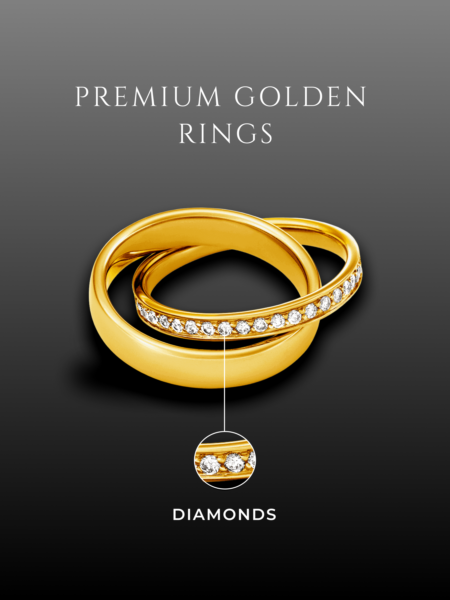
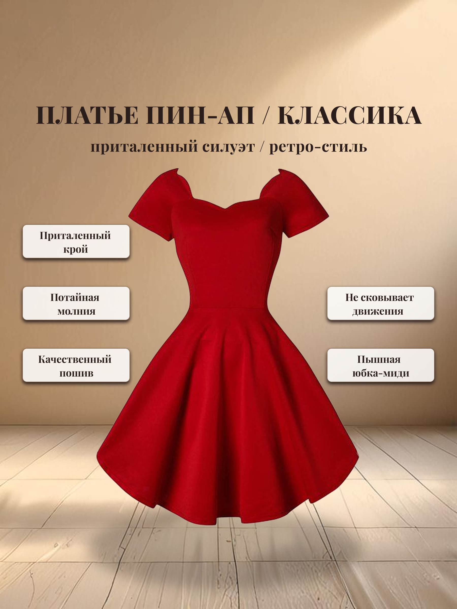
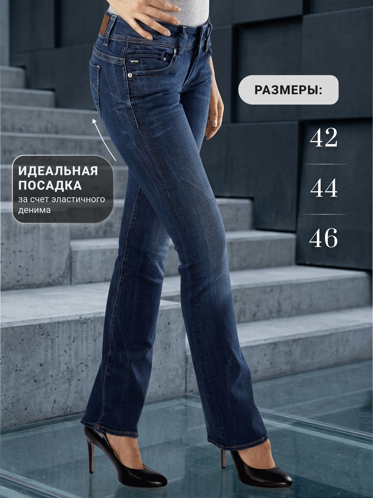
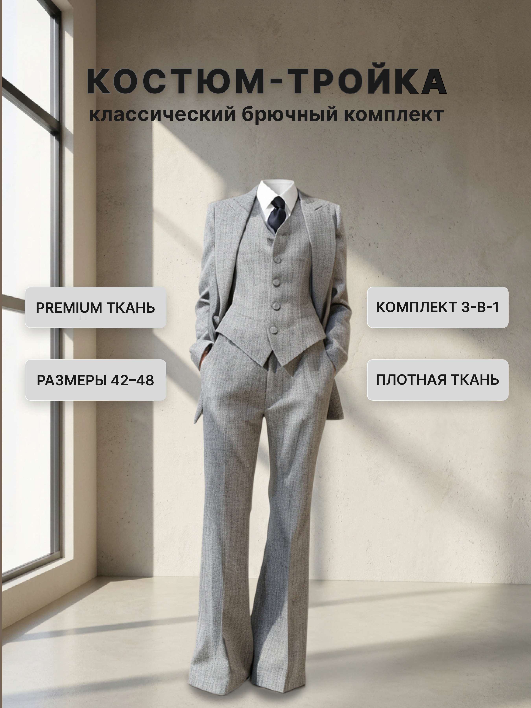
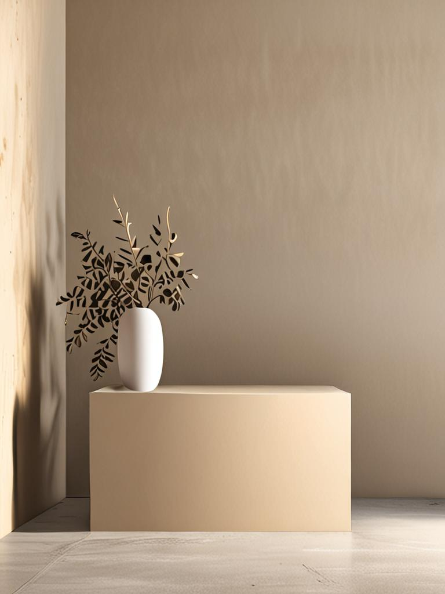
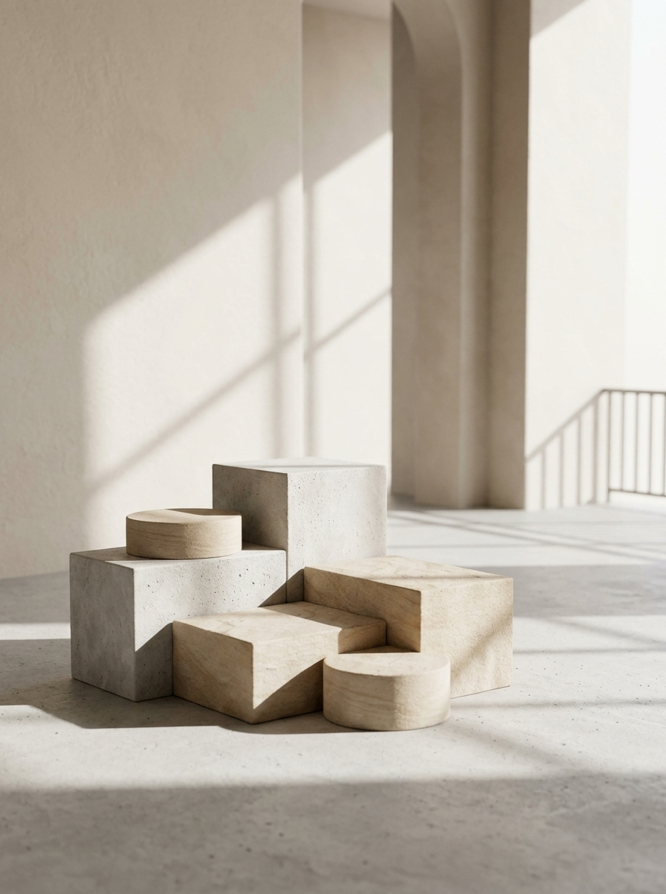
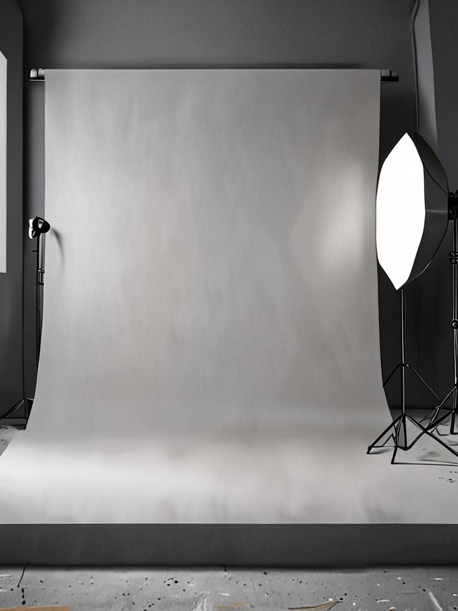
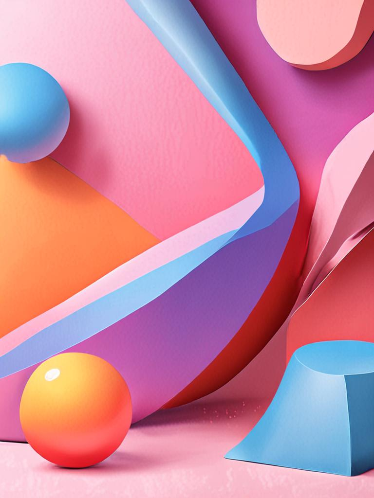

# My-design-portfolio
Some of my design works can be found here

Вы можете ознакомиться с некоторыми из моих дизайн-проектов и визуальных работ здесь. Я специализируюсь на создании чистых, современных и коммерчески привлекательных карточек товаров и графики с особым вниманием к деталям, типографике и композиции.

## 💍 Проект 1: Карточка товара (Золотые кольца)
**Описание:** Промо-карточка товара, разработанная для ювелирного бренда.
**Задача:** Разработать глубокий темный фон, выстроить чистую иерархию заголовков и сделать акцент на деталях.
**Инструменты:** Figma, композиция, иерархия, цветокоррекция, позиционирование слоев и визуальная группировка.

---

## 👗 Проект 1: Карточка товара - Платье «Пин-ап / Классика»
**Описание:** Промо-карточка женского платья приталенного силуэта в ретро-стиле.
**Задача:** Выверенная композиция с центральным расположением объекта, гармоничное сочетание заголовков и аккуратные плашки-выноски с ключевыми преимуществами модели (приталенный крой, потайная молния, качественный пошив, пышная юбка-миди).
**Инструменты:** Figma, работа с сеткой, инфографика и текстовая иерархия, работа с ИИ-инструментами.

---

## 👖 Проект 2: Карточка товара - Джинсы (Линейка размеров)
* **Описание:** Карточка демонстрации джинсовых изделий с акцентом на посадку и размерную сетку.
* **Задача:** Чистое вертикальное зонирование макета, выделенный блок размеров (42, 44, 46) и информационная выноска с указанием преимуществ эластичного денима.
* **Инструменты:** Figma, компоновка блоков и визуальный баланс.

---

## 👔 Проект 3: Карточка товара - Костюм-тройка
* **Описание:** Презентация классического брючного комплекта для строгого гардероба.
* **Задача:** Премиальная эстетика, строгий минималистичный фон, контрастные текстовые блоки с описанием ткани и комплектации (комплект 3-в-1, размеры 42–48).
* **Инструменты:** Figma, стилевое оформление и работа с акцентами, работа с ИИ-инструментами.

---

## 🤖 Проект 4: Работа с ИИ - Генерация фонов и концептов
* **Описание:** Исследование и применение нейросетей для создания атмосферных фонов, текстур и визуальных идей, усиливающих глубину коммерческого дизайна.
* **Задача:** Интеграция синтезированных нейросетями элементов в единую дизайн-концепцию, ручная цветокоррекция, балансировка света и адаптация под стандарты маркетплейсов.
* **Инструменты:** ИИ-инструменты для генерации концептов.

---

## 💎 Проект 5: Карточки украшений — ИИ-генерация, ретушь и визуальная подача
- **Описание:** Серия промо-визуалов и карточек для украшений: портрет модели с серьгами, кадр с характеристиками изделия и акцентный визуал с кристаллами и логотипом *VELVÉ accessories*.
- **Задача:** 
  - **1-е фото (`3_2.jpg`):** модель полностью сгенерирована с нуля, выполнена ручная ретушь всего изображения в Photoshop.
  - **2-е фото (`6_2.jpg`):** сгенерирован фон, проработаны тени и выполнена цветокоррекция/фильтрация серёжек с выводом размеров (`2,5 см`, вес `5 г`).
  - **3-е фото (`main card 2.jpg`):** добавлены блеск и кристаллы, оформлены надписи и выполнена финальная ретушь кадра.
- **Инструменты:** Генерация с помощью ИИ, Adobe Photoshop, работа со светом и тенями, ретушь, типографика и композиция.

---

 📬 Контакты
- **Telegram:** @krsstrkv
- **Email:** s.kristik@gmail.com
